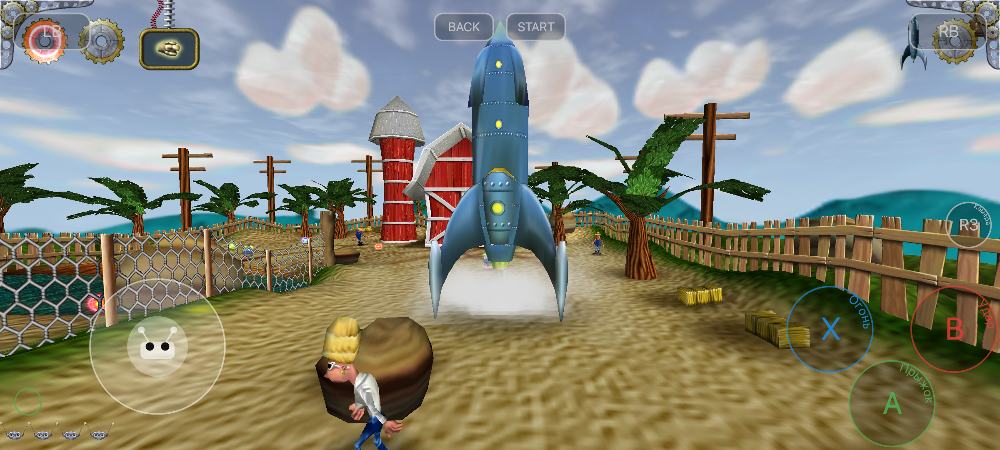

<div align="center">

# Otto Matic — Android Port

**Unofficial native Android port of the 3D action-adventure game _Otto Matic_**

**🇬🇧 English** · [🇷🇺 Русский](README.ru.md)

[](https://github.com/nullch/ottomatic-android/actions/workflows/build.yml)
[](LICENSE.md)


[Telegram: @nullch](https://t.me/nullch) · [Channel: @nullchdays](https://t.me/nullchdays)

</div>

---

## Screenshots

<!--
  PLACE YOUR SCREENSHOT HERE.
  Replace the file docs/screenshots/screenshot.png with your own (keep the same name),
  or change the path below. Landscape 16:9 (e.g. 1280x720) looks best.
  To add more, put them in docs/screenshots/ and add more  lines.
-->
<p align="center">
  
</p>

---

## About

Otto Matic is a 3D action-adventure game by Pangea Software (2001). Iliyas Jorio's
[modern desktop version](https://github.com/jorio/OttoMatic) is the base for this port.
This repository adds an Android layer on top of it: a native build with SDL3, an OpenGL → GLES2
translation layer, an on-screen gamepad, and Russian localization.

## Features

- Native Android build (C/C++ via NDK, SDL3 for window, input and audio glue).
- The game's fixed-function OpenGL is translated to OpenGL ES 2.0 with [gl4es](https://github.com/ptitSeb/gl4es).
- On-screen touch gamepad. It hides automatically when a physical gamepad is connected.
- Bluetooth / USB gamepads through SDL3.
- 7 languages: English, Français, Deutsch, Español, Italiano, Svenska, Русский.
  Language selection on first launch; Cyrillic glyphs added to the game's bitmap font
  (see [`tools/fontgen`](tools/fontgen/README.md)).

**Limitations:** only `arm64-v8a` is built, the minimum Android version is 7.0 (API 24),
and there is no prebuilt APK in this repository — you build it yourself (see below).

## Building

### Requirements

| Tool            | Version                        |
|-----------------|--------------------------------|
| Git             | any recent version             |
| JDK             | 17                             |
| Android SDK     | API 35                         |
| Android NDK     | 27.0.12077973                  |
| CMake           | 3.22.1                         |
| Android Studio  | Jellyfish (2024.1.1) or newer  |

Android Studio can install the SDK, NDK and CMake for you (SDK Manager).

### Steps

**1. Clone the repository**

```bash
git clone https://github.com/nullch/ottomatic-android.git
cd ottomatic-android
```

**2. Download dependencies and apply patches**

The script clones the upstream game (for `Data/` and the Pomme library), SDL3 and gl4es
into `third_party/` at pinned commits, applies the patches from `patches/` and copies the
font overlay from `game-data-overlay/` over the game data.

```bash
# Linux / macOS
./setup.sh

# Windows (cmd or PowerShell)
setup.bat
```

**3. Build**

Either open the folder in Android Studio (**File → Open**), wait for the Gradle sync and press **Run**,
or build from the command line:

```bash
# Linux / macOS
./gradlew assembleDebug

# Windows
gradlew.bat assembleDebug
```

The APK is written to `app/build/outputs/apk/debug/app-debug.apk`.
Install it with `adb install -r app/build/outputs/apk/debug/app-debug.apk`.

> The first build compiles SDL3, gl4es and the whole game, so it takes a while.

## Game data

The game data (`Data/`) comes from the upstream repository and is packed into the APK during the build.
On first launch the app unpacks it to its internal storage.

To use your own modified `Data/` folder, put it here (it must contain `System/gamecontrollerdb.txt`):

```
/sdcard/Android/data/ru.nullch.ottomaticfork/files/Data/
```

## Project layout

```
ottomatic-android/
├── app/                 Android app module (Gradle, Java launcher, touch gamepad, CMake)
├── game/                Game source code (upstream src/ patched for Android)
├── game-data-overlay/   Files copied over upstream Data/ (Cyrillic font atlas)
├── patches/             Patches for gl4es and Pomme
├── tools/fontgen/       Scripts that generate the Cyrillic font
├── docs/                Screenshots and images for the docs
├── licenses/            Third-party license texts
├── setup.sh / setup.bat Dependency download + patching
└── third_party/         Created by setup (SDL3, gl4es, upstream game) — not committed
```

## Credits and legal

Otto Matic is being re-released by Iliyas Jorio at <https://github.com/jorio/OttoMatic>
under the [CC BY-NC-SA 4.0 license](https://github.com/jorio/OttoMatic/blob/master/LICENSE.md)
with permission from Pangea Software, Inc.

© 2001 Pangea Software, Inc. Otto Matic is a trademark of Pangea Software, Inc.
Portions © 2021 Iliyas Jorio. Android port portions © 2026 nullch.

This Android port is an unofficial fan project. It is not affiliated with or endorsed by
Pangea Software, Inc. It is distributed under the same license,
[CC BY-NC-SA 4.0](LICENSE.md) — **non-commercial use only**, with attribution, and
derivatives must be shared under the same license. Changes to the original were made
(Android port, GLES2 translation, touch controls, Russian localization).

Third-party components (SDL3, gl4es, Pomme, Liberation fonts) are listed in [THIRD_PARTY.md](THIRD_PARTY.md).
See also [NOTICE.md](NOTICE.md).

## Contact

- Telegram: [@nullch](https://t.me/nullch)
- Telegram channel: [@nullchdays](https://t.me/nullchdays)
- Bugs and ideas: [GitHub Issues](https://github.com/nullch/ottomatic-android/issues)
